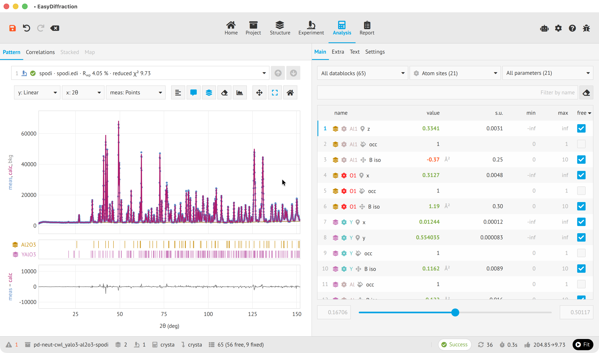

<section class="ed-landing" aria-labelledby="landing-heading" markdown>

<nav class="ed-landing__interfaces" aria-label="Explore EasyDiffraction interfaces" markdown>

[:lucide-globe:{ aria-hidden="true" } Web app](application/browser.md "Web app documentation")
[:lucide-monitor:{ aria-hidden="true" } Desktop app](application/desktop.md "Desktop app documentation")
[:simple-python:{ aria-hidden="true" } Python](python/index.md "Python library documentation")
[:lucide-square-terminal:{ aria-hidden="true" } Command Line](cli/index.md "Command Line documentation")

</nav>

# Making diffraction data analysis and modelling easy { #landing-heading }

Calculate diffraction patterns, refine your structural model and understand your results. Try it directly in your browser.

[Try the web app](https://enhantica.github.io/edi/webapp/){ .md-button .md-button--primary }
[Get started](user-guide/index.md){ .md-button }

<figure class="ed-landing__preview">
  
</figure>

</section>
