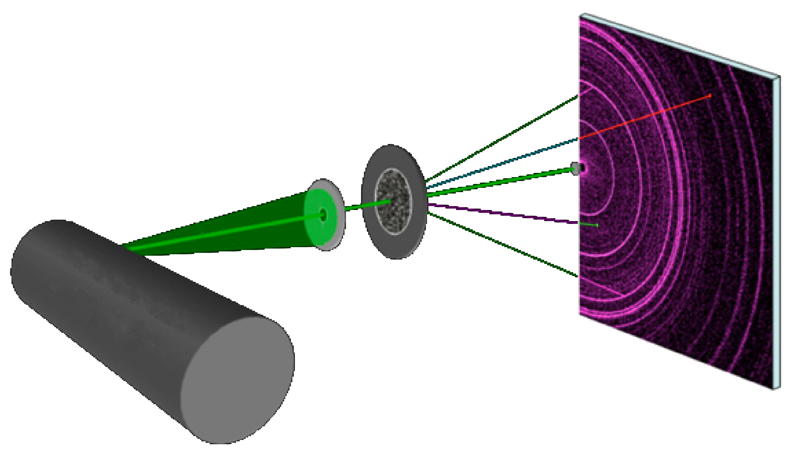
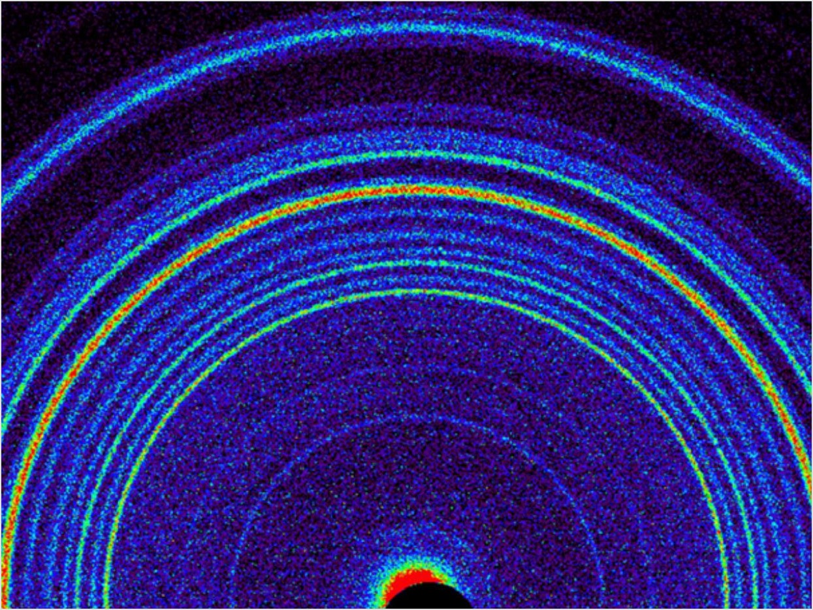
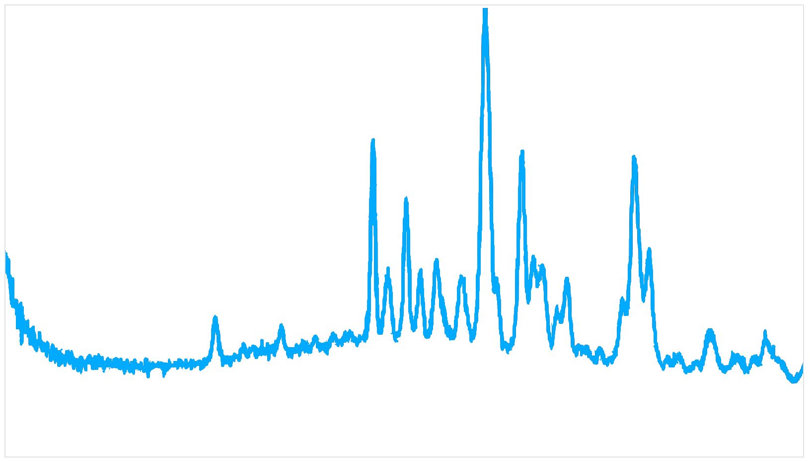
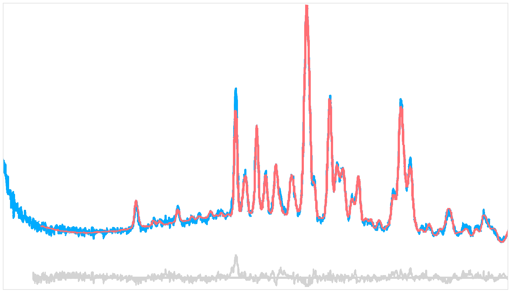
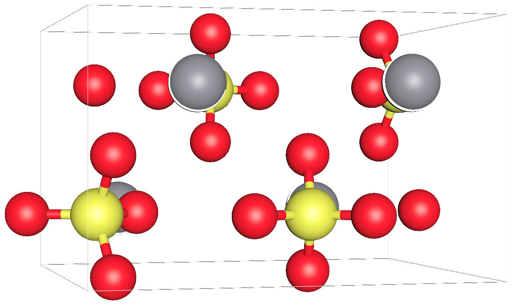

# From measurement to analysis

EasyDiffraction compares a crystallographic model with diffraction measurements. Understanding where that comparison begins helps you choose suitable inputs and recognise what a fit can establish.

## Acquisition, reduction and analysis

<ol class="ed-workflow-diagram ed-concept-flow" style="--ed-flow-columns:3" markdown="1" aria-label="From detector measurements to analysis">
<li markdown="1">[:material-microscope: Acquisition](#acquisition)</li>
<li markdown="1">[:lucide-filter: Reduction](#reduction)</li>
<li markdown="1">[:material-calculator: Analysis](#analysis)</li>
</ol>

=== ":material-microscope: Acquisition"

    

    Record the detector response while the sample scatters the incident beam. This example uses a two-dimensional detector.

    

    <figure><figcaption>Beam, sample and detector</figcaption></figure>
    <figure><figcaption>Raw detector image</figcaption></figure>
    

    

=== ":lucide-filter: Reduction"

    

    Apply the relevant corrections and turn detector measurements into observations with uncertainties. For powder diffraction, these are often a one-dimensional intensity profile.

    

    <figure><figcaption>Reduced diffraction pattern</figcaption></figure>
    

    

=== ":material-calculator: Analysis"

    

    Compare a calculated pattern with the observations, refine the model and inspect the result. **EasyDiffraction focuses on this stage.**

    

    <figure><figcaption>Measured, calculated and residual signals</figcaption></figure>
    <figure><figcaption>Crystal structure model</figcaption></figure>
    

    

??? info "Illustration credits"

    These illustrations are reused from the [earlier EasyDiffraction concept guide](https://docs.easydiffraction.org/lib/latest/user-guide/concept/). Its detector and diffraction example is credited to [Bish et al., Science (2013)](https://doi.org/10.1126/science.1238932). They illustrate the processing stages; the first-refinement tutorial uses its own measured example.

Keep the reduction history and experimental context with the project: they affect how uncertainties and agreement factors should be interpreted.

## A model of the sample and the experiment

The calculated intensity depends on more than atom positions. EasyDiffraction separates the model into two connected parts:

| Part | Describes | Examples |
| --- | --- | --- |
| [:material-puzzle: Structure](analysis-workflow/structure.md) | The crystalline sample | Unit cell, symmetry, atom sites, occupancies, displacement parameters |
| [:material-microscope: Experiment](analysis-workflow/experiment.md) | How it is observed | Wavelength or time-of-flight calibration, peak profile, background, scale and excluded regions |

A disagreement between measured and calculated patterns can therefore have several causes. A peak-position error may come from the cell or calibration; a broad mismatch underneath peaks may come from the background; an intensity mismatch can involve the structure as well as experiment settings.

## Calculation before refinement

<ol class="ed-workflow-diagram ed-concept-flow" style="--ed-flow-columns:3" markdown="1" aria-label="Model calculation and comparison">
<li markdown="1">[:material-puzzle: Structure + experiment](#a-model-of-the-sample-and-the-experiment)</li>
<li markdown="1">[:lucide-chart-no-axes-combined: Calculated pattern](../physics/rietveld.md#eq-rietveld-pattern)</li>
<li markdown="1">[:lucide-git-compare: Compare with observations](#refinement-is-an-optimisation-problem)</li>
</ol>

A calculation predicts the diffraction signal from the current structure and experiment. It does not need measured intensities. Use it to inspect peak positions and the influence of the model before fitting.

A refinement requires observations to compare against. It changes the parameters marked as free in order to improve agreement with those observations. Parameters that remain fixed still contribute to the calculated pattern.

## Refinement is an optimisation problem

A least-squares fit reduces a weighted difference between observations and calculations. The starting model, free-parameter set, constraints, excluded regions and minimizer conditions all influence the result.

Start from a physically meaningful model. Inspect the initial pattern, allow parameters to vary deliberately, and review the result after each meaningful change. Adding more free parameters may reduce a residual without making the model more informative.

## Least squares and Bayesian analysis {#least-squares-and-bayesian-analysis}

Both compare a model with observations, but summarise parameter uncertainty differently.

| Approach | What it reports |
| --- | --- |
| Least squares | A best-fit parameter set and, when the covariance can be estimated, standard uncertainties and correlations |
| Bayesian sampling | A posterior distribution combining a likelihood with prior information, from which credible intervals and correlations can be summarised |

The fitting instructions in this documentation use **least squares**. Its [objective and covariance conventions](../physics/minimization.md) explain the reported uncertainties. Bayesian sampling is a separate workflow; the older library's sampler choices should not be assumed to be available in this application.

## A result needs interpretation

Convergence describes how the optimisation ended. It does not by itself establish that the sample model is correct or that all uncertainty sources have been captured.

Inspect the observed and calculated signal, the residual, parameter uncertainties and correlations, and the physical plausibility of the result. [Fit quality](fit-quality.md) explains these checks in more detail.

## The same ideas in every interface

The app makes these relationships visible. Python lets you express them in a script or notebook. The Command Line runs the analysis already declared by a saved project. All use the same [project model](analysis-workflow/project.md).
