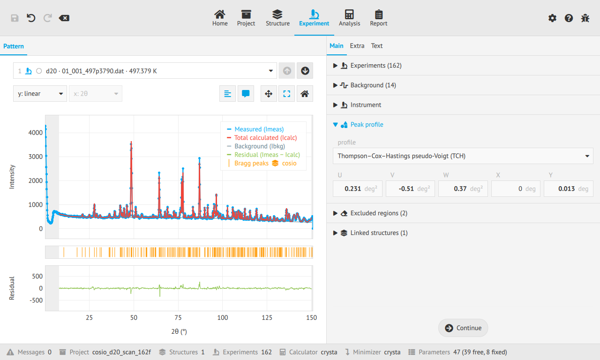

# Making diffraction data analysis and modelling easy

Explore your data, refine your model and understand what the fit is telling you. Start in the
application, a Python notebook or your terminal, and keep the same project as your work grows.

[Try the web app](https://enhantica.github.io/edi/webapp/){ .md-button .md-button--primary }
[Get started](get-started/index.md){ .md-button }

## Choose how you work

-   **Application**

    ---

    Explore your model and pattern in a visual workspace, on your desktop or in your browser.

    [Explore the application](get-started/web.md)

-   **Python library**

    ---

    Use `edi` in a script or notebook and bring diffraction analysis into your scientific workflow.

    [Work in Python](reference/python.md)

-   **Command line**

    ---

    Run the analysis declared by a project and make repeated runs part of your workflow.

    [Use the command line](reference/cli.md)

## Learn the workflow once

Shared guides explain the science and project model. Application, Python and command-line
instructions appear together where the steps differ.

1. [Load a project](guides/load.md).
2. [Define the structure](guides/structure.md).
3. [Calculate the pattern](guides/calculate.md).
4. [Refine the model](guides/refine.md).
5. [Understand the result](guides/results.md).

[Follow the analysis guide](guides/index.md){ .md-button }
